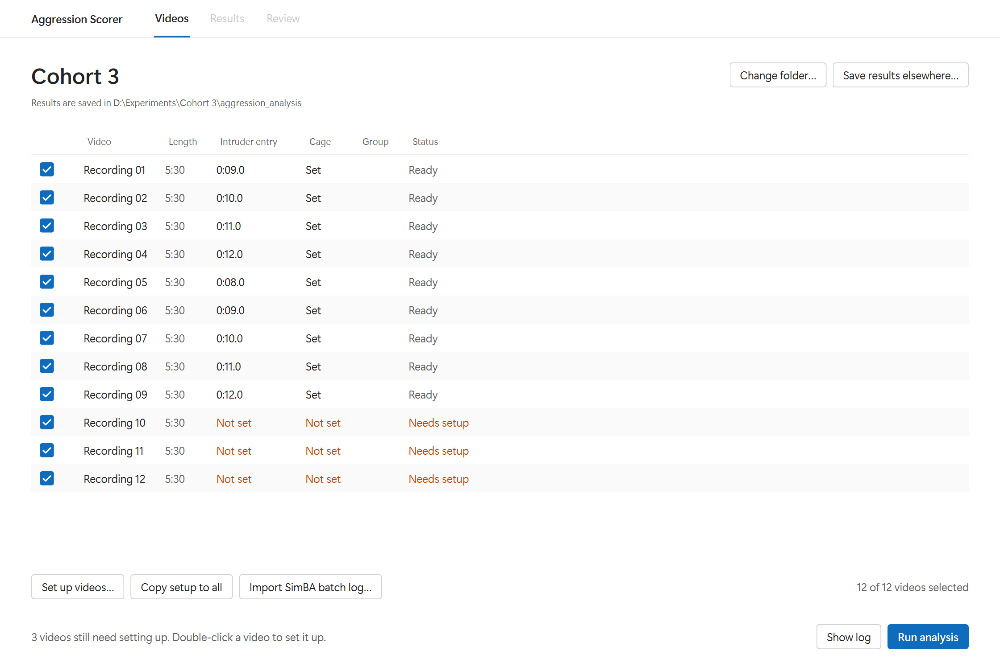
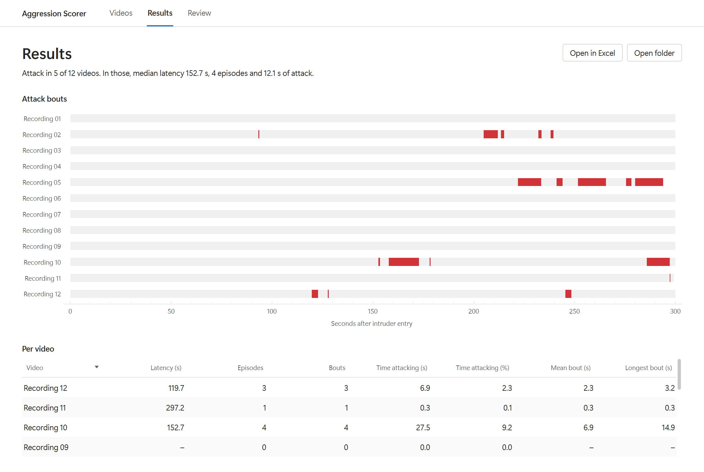
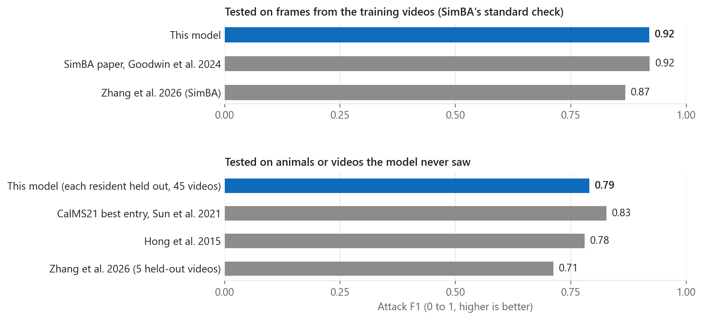
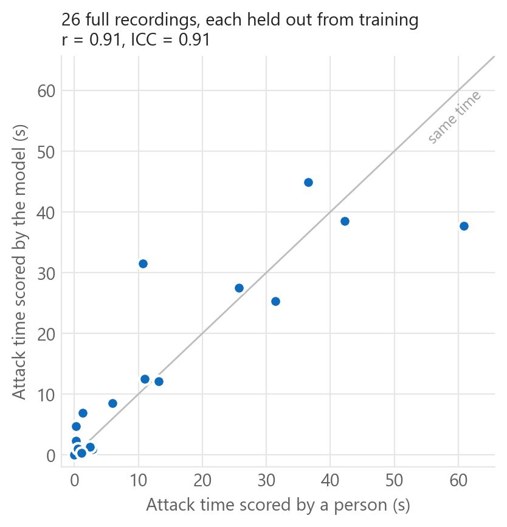

# Aggression Scorer

Aggression Scorer finds attacks in mouse resident-intruder videos for you. Point it at a folder of recordings, mark the
cage and the moment the intruder goes in, and press Run. It tracks both mice, scores every frame, and gives you
latency to the first attack, the number of attacks and the time spent attacking for each video, plus an Excel file
and plots.

You don't need to know how to code. Everything happens in a normal app window.



## What you need

- A computer running Windows 10 or 11, macOS, or Linux. No graphics card needed.
- About 6 GB of free space and an internet connection for the install, plus about 250 MB for every 5-minute video
  you score.
- Your own videos. The app does not come with any. See [Your videos](#your-videos) below.

## Install (once)

### Windows

1. On this page click the green **Code** button, then **Download ZIP**. Unzip it somewhere with a short path, like
   `C:\AggressionScorer`.
2. Open the folder and double-click **install.bat**. It installs Python, ffmpeg, everything else and the trained
   model. This takes 30 to 60 minutes. If Windows shows a blue "Windows protected your PC" box, click
   **More info**, then **Run anyway**.
3. When it says Done, double-click **start.bat** to open the app.

### Mac

1. Install [Homebrew](https://brew.sh) if you don't have it (copy the one line on their page into Terminal).
2. On this page click **Code**, then **Download ZIP**, and unzip it in your home folder.
3. Open **Terminal**, type `cd ` (with a space), drag the unzipped folder onto the Terminal window, and press Enter.
4. Type `bash install.sh` and press Enter. This takes 30 to 60 minutes.
5. To open the app, run `bash start.sh` in that same folder.

### Linux (Ubuntu 22.04)

```
sudo apt install python3.10 python3.10-venv ffmpeg libxcb-cursor0 git
git clone https://github.com/Kushaan-SSSK/aggression-classifier.git
cd aggression-classifier
bash install.sh
bash start.sh
```

On newer Ubuntu versions, add Python 3.10 from the deadsnakes PPA first.

The app has been tested on Windows 11. The Mac and Linux steps use the same install but have not been tested yet, so
please open an issue if something goes wrong.

## Use the app

1. Click **Choose folder...** and pick the folder that holds your videos.
2. Double-click a video to set it up:
   - drag a box around the cage floor (just the top-down view of the cage)
   - drag the slider to the moment the intruder is put in and click **Mark entry**
   - click **Next** to go to the next video. Your box is copied to the other videos of the same size, so for most
     videos you only have to mark the entry.
3. If you want to compare groups (for example control and treated), double-click the **Group** column and type a
   name for each video.
4. Press **Run analysis**. Tracking the mice is the slow part, about 8 minutes for every 5 minutes of video on a
   normal laptop, so a big folder is a good overnight job. You can keep using your computer while it runs.
5. When it finishes, the **Results** page opens.



On the **Results** page each red block is one attack. Click a block, or double-click a row in the table, to watch
it. **Open in Excel** gives you the numbers for your stats. On the **Review** page you can play the scored clip next
to the model's attack probability and jump from one attack to the next. Spot-check a few videos the first time you
use it on a new setup.

Everything is saved in a new folder called `aggression_analysis` inside your video folder. Your original videos are
never changed. If your folder path is very long, Windows can't handle it, so the app will ask you to pick a shorter
place with **Save results elsewhere...**.

## Your videos

- A top-down view of the home cage. A side view in the same frame is fine, you just box the top view.
- The recording starts before the intruder is put in.
- At least 5 minutes after the intruder goes in. The app scores the 5 minutes after entry.
- Any resolution or frame rate, and mp4, avi, mov or mkv files.
- One experiment per folder.
- The model was trained on mice in standard home cages with bedding, filmed from above. If your setup looks very
  different, check more videos by eye.

## What you get

`results.xlsx` has one row per video and one row per attack bout.

| Column | Meaning |
|---|---|
| Latency (s) | Seconds from intruder entry to the first attack. Empty if there was no attack. |
| Episodes | Attacks less than 1 second apart counted as one fight. Usually the best "number of attacks". |
| Bouts | Every separate attack the model found |
| Time attacking (s) and (%) | Total time spent attacking |
| Mean bout, Longest bout (s) | How long the attacks lasted |
| recording_start_s (bouts sheet) | Where each attack is in your original video, so you can find it in any player |

## How accurate is it

The model was trained on 45 resident-intruder videos from 31 resident mice, about 127,000 frames hand-scored by an
experienced scorer, 7,200 of them attack. We tested it the way the SimBA paper does, and also on mice it never saw
during training, which is the number to expect on your own videos.



| Model | How it was tested | Attack F1 | Precision | Recall |
|---|---|---|---|---|
| **This model** | 5-fold, shuffled frames (SimBA's standard check) | **0.92** | 0.86 | 0.99 |
| SimBA, [Goodwin et al. 2024](https://static1.squarespace.com/static/5b1b659871069912b3022368/t/666b3f0bae03e61fecdaab73/1718304536255/Goodwin+2024+NN.pdf) | shuffled frames | 0.92 | 0.94 | |
| [Zhang et al. 2026](https://www.nature.com/articles/s41467-026-69254-x) (SimBA) | SimBA's training check | 0.87 | 0.80 | 0.95 |
| **This model** | every resident held out in turn, 45 videos | **0.79** | 0.75 | 0.83 |
| [Zhang et al. 2026](https://www.nature.com/articles/s41467-026-69254-x) (SimBA) | 5 held-out videos | 0.71 | 0.62 | 0.84 |
| [Hong et al. 2015](https://authors.library.caltech.edu/records/1q5fp-0wv10/files/PNAS-2015-Hong-E5351-60.pdf?download=1) | separate test videos | 0.78 | 0.76 | 0.80 |
| CalMS21 best entry, [Sun et al. 2021](https://arxiv.org/abs/2104.02710) | held-out test sequences | 0.83 | | |

F1 runs from 0 to 1, where 1 means the model agrees with the human scorer on every single frame. Shuffling frames
puts neighbouring frames of the same attack in both the training and the test set, so that check always reads high.
Holding out whole mice is harder and more honest. On both checks this model is in line with or ahead of other published
attack classifiers. The other numbers come from different videos, so treat the comparison as a rough guide, not a
head-to-head race.

For the measures you would actually report, the model's attack time per video matches the human scorer closely:



On 26 full recordings, each scored by a model that never saw that mouse, total attack time correlated at r = 0.91
(ICC 0.91) with the human scorer. The number of attack episodes agreed with ICC 0.86, and the model found attacks in
every recording that had them and none in the recordings without. Allowing 1 second of timing slack, frame agreement
rises to 0.92. On six videos scored by two people, the model agreed with the main scorer as closely as the second
person did.

**Weak spots.** Very short bites (under half a second) are the hardest part: the model catches about half of them,
and the second human scorer missed many of them too. Because of that, latency to the very first bite is less
reliable (r = 0.55) than attack time or attack counts. Report latency to the first sustained attack if you can.

## Command line (optional)

Everything the app does can also be run from a terminal, one step at a time, from the program folder. List your
videos in `data/annotations/video_manifest.csv` first (copy `config/video_manifest.template.csv`), then:

```
.venv-simba/Scripts/python -m behavior_pipeline preprocess   # on Mac and Linux: .venv-simba/bin/python
.venv-dlc/Scripts/python   -m behavior_pipeline pose
.venv-simba/Scripts/python -m behavior_pipeline resident
.venv-simba/Scripts/python -m behavior_pipeline convert
.venv-simba/Scripts/python -m behavior_pipeline project
.venv-simba/Scripts/python -m behavior_pipeline infer --clf Attack
.venv-simba/Scripts/python -m behavior_pipeline report --clf Attack
```

Settings live in `config/pipeline.yaml`. With your own labelled videos you can retrain (`train --clf Attack`) and
check accuracy the same way as above (`evaluate --clf Attack`, which writes both the shuffled-frame and the
held-out-mouse numbers).

## Built with

[DeepLabCut](https://github.com/DeepLabCut/DeepLabCut) SuperAnimal-TopViewMouse for tracking,
[SimBA](https://github.com/sgoldenlab/simba) for features, and scikit-learn for the classifier.

Made by Kushaan Sharma. Questions or problems: open an issue on this page.
